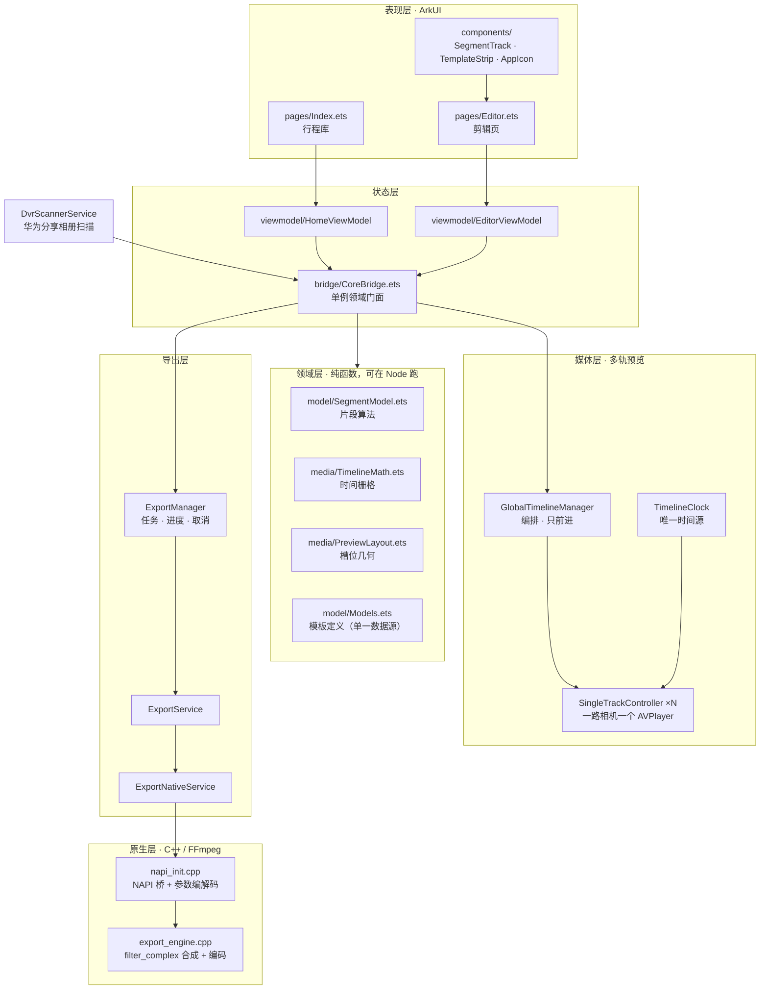

# 剪单 · Smart-Drive-Media

> 把行车记录仪的六路循环录像，剪成一条可以直接发出去的行程短片。

HarmonyOS 6（API 22）原生应用 · ArkTS / ArkUI + C++ / FFmpeg 双栈

-3C6E71)


---

## 演示

▶️ **[观看演示视频](https://github.com/godlk96/Smart-Drive-Media/blob/main/docs/media/demo.mp4)** · 76 MB

点开后是 GitHub 自带的播放器页面，可直接播放或下载。

> GitHub 会剥离仓库内 Markdown 的 `<video>` 标签，所以这里没法内联播放。要在 README 里嵌一个真正能播放的播放器，只能使用 GitHub 的 **user-attachments** 链接（把视频拖进任意 issue/PR 评论框上传后得到的 `https://github.com/user-attachments/assets/...` 地址）—— 该地址由 GitHub 渲染成播放器。详见下方「已知限制」。

---

## 1. 这是什么

行车记录仪只会做一件事：**每 60 秒切一个文件，六路摄像头各存一份，循环覆盖**。

于是「今天跑了一趟川西」在相册里就是 480 个毫无关联的片段：`DVR_LoopRecording_2026-09-11_16-58-56_front_camera.mp4`、`..._back_camera.mp4`、`..._left_camera.mp4`……文件名里只有时间戳和机位，没有任何东西告诉你它们属于同一趟行程，也没有任何东西帮你把六路画面拼成一幅。

**剪单要做的事**：认出这些片段属于同一趟行程 → 按时间轴拼成一条连续的行程 → 让你像剪一条普通视频那样剪它 → 导出成一条 MP4。

它解决的不是「怎么剪视频」，而是**「怎么把一堆没有叙事结构的监控素材，变成一段有叙事结构的行程记录」**。

---

## 2. 核心亮点

### 2.1 六路机位 → 一块画布：模板驱动的多机位合成

应用内置 6 套机位模板（T1–T6），每套模板声明它需要哪几路素材、画布多大、每路画面占画布的哪个矩形：

| 模板 | 必需机位 | 构图 |
|---|---|---|
| T1 | 前 + 后 | 上下分屏 8:9 |
| T2 | 前 + 左 + 右 | 三格 32:27 |
| T3 | 左 + 右 | 左右并排 32:9 |
| T4 | 左前 + 前 + 右前 | 三格 32:9 |
| **T5**（默认） | 仅前视 | 单画面 16:9 |
| T6 | 四机位 | 2×2 四格，画布 3840×2160 |

关键设计：**模板定义是唯一数据源**。`TEMPLATE_DEFINITION_MAP`（`entry/src/main/ets/model/Models.ets`）同时被预览层（`media/PreviewLayout.ets`）和原生导出层（`cpp/export_engine.cpp`）读取，所以「预览里看到的分屏」和「导出后的分屏」在构造上不可能不一致 —— 这两者曾经漂移过（T4 预览用 0.25/0.5/0.25，模型用 0.3333/0.3334/0.3333），修法不是两边各改一次，而是让它们读同一份定义。

素材不足时模板卡片降到 40% 不透明度并拦截点击，提示「缺少 X 视角，无法使用该模板」。

### 2.2 多轨实时预览：收敛式 reconciler + 单一时间源

六路画面意味着**六个 `AVPlayer` 同时解码**。难点不是播放，而是**让六个独立解码器在拖动、变速、跳段之后仍然看起来像一条时间轴**。

架构上分三层：

- **`GlobalTimelineManager`** —— 编排者。它只在**前进**方向推进（`advanceFromMaster(globalMs)` 丢弃 `next <= playheadMs`），播放中才推进，拖拽中不推进。
- **`TimelineClock`** —— **页面唯一的时间源**。它不直接驱动播放器，而是产出「期望状态」（全局时间 + 是否播放 + 倍速），交给下一层。
- **`SingleTrackController` × N** —— 每路相机一个，是**幂等的收敛器**：调用方只给 `DesiredState`，控制器自己决定「该 seek / 该换段 / 什么都不用做」。

这套结构解决了几类真实故障：

- **寻道风暴**：拖动进度或手柄时，60Hz 的手势事件如果每次都直接 seek，原生解码器会丢帧紊乱。做法是 UI 气泡 60Hz 本地实时响应，而**预览寻道按 80ms 节流**发送，松手（`PanGesture.onActionEnd`）时补发一次最终精确寻道。
- **抖动导致的反复纠正**：时钟的漂移必须**连续持续 `DRIFT_CONFIRM_MS`** 才判定为真漂移并触发纠正 seek，否则忽略。避免「seek → 解码慢 → 又判定漂移 → 再 seek」的自激循环。
- **seek 卡死**：`SEEK_STUCK_MS = 1500` 后主动释放并重试（`releaseStuckSeekIfNeeded()`），配合 `PLAYLIST_ADVANCE_FAIL_LIMIT = 3`、`SURFACE_WAIT_MAX_MS = 2000` 兜底。
- **变速不一致**：`speedEnumForRate` 的阈值链曾经漏掉 `SPEED_FORWARD_1_50_X = 6`，导致 1.5× 实际按 1.25× 播放 —— 这是「预览与导出不一致」的真正根因。

### 2.3 原生 FFmpeg 导出管线

导出走 `ExportManager → ExportService → ExportNativeService → NAPI → C++/FFmpeg`：

```
runExportEnginePipeline(frontUris, backUris, sideUris, templateId,
                        expectedDurationSec, outputPath,
                        startMs, endMs, segments)
```

原生侧（`entry/src/main/cpp/export_engine.cpp`，约 2000 行）动态拼装一条 `filter_complex` 图：**逐片段** `trim` → `setpts=(PTS-STARTPTS)/<speed>` → `fps=<源帧率>`（把倍速折算进帧数并统一时基）→ 按模板铺进画布 → `format=yuv420p,setsar=1`，多片段用 `concat` 拼接。

音频**不能**沿用早期的流拷贝方案，因为倍速和静音需要 PCM：`atrim` → `asetpts` → `atempo=<speed>` → `volume=<1|0>` → `aresample=48000`。静音片段用 `volume=0` 而不是丢弃音轨，以保证时长对齐。

编码器选择按 **HEVC → H.264 → MPEG-4** 回退。FFmpeg 用 OH SDK 的 clang 交叉编译，`--enable-ohcodec --enable-encoder=h264_oh,hevc_oh,aac --disable-gpl --disable-nonfree`，走硬件编码器 `h264_oh` / `hevc_oh`。

> 早期版本这里踩过一个典型的坑：FFmpeg 是以 `--disable-encoders --enable-encoder=mpeg4` 编译的，输出只能是 MPEG-4 Part 2（mp4v），HEVC/H264 查找一律返回 `nullptr`，且音频只能流拷贝 —— 于是倍速和静音根本不生效。这个问题被完整记录在 `docs/superpowers/notes/2026-10-13-export-ffmpeg-note.md`，包括错误串到函数的分诊表。

### 2.4 片段编辑状态机：`RAW_FULL` ↔ `SEGMENTED`

剪辑页有两种模式，切换是无缝的：

- **`RAW_FULL`（全片）**：`segments` 表现为单一虚拟全片 `[0, totalDurationSec]`，无手柄、无删除按钮，直接调速/静音/导出。
- **`SEGMENTED`（多片段）**：1–3 个独立片段，只有**当前选中**的片段显示左右手柄。

规则上刻意做了几处「反直觉但正确」的选择：

- **首刀是「圈高光」而不是「切掉」**：在播放头处生成默认 15 秒的选区（剩余不足则到片尾，且强制 ≥10 秒），而不是默认延伸到片尾。
- **手柄硬阻挡（clamp）**：拖动碰到片头/片尾/相邻片段边界时直接顶住，**绝不推移或压缩相邻片段**，绝不允许重叠。单段最短 10 秒。
- **落刀规则**：片段内切分要求该片段 ≥20 秒且落刀点距两端各 ≥10 秒；空档落刀则新建 15 秒片段（受后段边界截断，且 ≥10 秒）。最多 3 段。
- **物理删除**：`✕` 直接从数组 `splice` 移除，播放头**不跳变**，焦点顺延到右侧片段（无则左侧）；删光后无缝重置回 `RAW_FULL`，提示「已恢复为完整视频」。

### 2.5 轨道布局的四条不变量（最值得讲的一处工程细节）

拖动片段手柄时最容易出现的 bug 是「拖动时后面的片段跟着动，松手又弹回去」。根因被拆成了四条不变量，并用离线测试钉死：

1. **空档恒建**：片头、每两段之间、片尾的空档项**必须始终存在**（即使宽度为 0），恒为 `2N+1` 项。因为空档项是「让出的那几秒」的唯一容器 —— 只在时长 >0 时才建，两段紧贴时就无处安放那 5 秒，整条轨道会被重新按比例分配。
2. **key 必须携带已提交边界**：`ForEach` 按 key 复用子组件时**不会重跑 item 生成函数**。只用 id 做 key，松手提交后新旧 key 相同 → 子组件原样复用 → 手里还是上一轮的旧边界。所以 key 要同时编入「相邻段 id」和「这一项自己的已提交边界秒数」。
3. **宽度绝对化**：段块与空档一律 `.width(轨宽 × 时长 / 片长)`，**禁止 `layoutWeight`**。权重是整行按比例分摊，任何一项数值不对都会让旁边的段被拉伸/压扁。
4. **手柄触摸区不得越界**：两个手柄各自锚在自己的边上，触摸区完全落在段块内，禁止用 `Row(){ 左手柄; Blank(); 右手柄 }` 流式排版 —— 块宽小于 88vp 时右手柄会被排到块内固定位置，越窄越抓不到真正的右边界。

这四条由 `tools/offline-test.mjs` 的 `checkGapItemsAlwaysBuilt`、`checkGapKeysCarryCommittedBounds`、`checkTrackUsesAbsoluteWidths`、`checkHandlesLiveInOverlayWithBigTouchAreas` 守卫。

### 2.6 行程识别：文件名即元数据

不做内容识别，而是**把文件名当结构化元数据解析**。只扫华为分享相册（`['华为分享', 'Huawei Share']`），命中两条正则：

```js
DVR_LoopRecording_\d{4}-\d{2}-\d{2}_\d{2}-\d{2}-\d{2}_.+_camera\.(mp4|mov|ts)
Sentry_\d{4}-\d{2}-\d{2}_\d{2}-\d{2}-\d{2}_[a-z]+\.(mp4|mov|ts)
```

同一秒切片的六路文件时间戳完全相同，因此按**精确时间戳**分桶（`slicesMap`）就能把六路归一成一个「切片」，再把切片按间隔串成行程。

一个刻意的设计：行程分组的间隔阈值 `TRIP_GAP_THRESHOLD_MS` 与时间轴栅格用的 `RUN_GAP_MS` **是同一个常量**，保证「算不算一趟行程」和「时间轴上算不算一段连续」永远不会各说各话。

### 2.7 工程化：让纯函数层可测

整个领域层（片段算法、时间栅格、槽位几何、模板定义）**不依赖任何 `@ohos.*` / `@kit.*`**，因此可以在 Node 里直接跑：

- `tools/offline-test.mjs`（990 行）：**131/131 通过**。它通过 `collectModules()` 遍历 import 图，**遇到 `@ohos.*` 就抛错** —— 用机制而不是纪律来保证纯函数层不被污染。
- 除单元断言外还有一批**结构守卫**：跨语言契约检查（ArkTS 模板契约 == 原生导出契约）、颜色令牌检查（17 个必需 token 的精确十六进制值）、禁用旧色值检查、模板命名一致性检查。
- `tools/typecheck-player.mjs`：4 个分组（`player` / `bridge` / `export` / `home`）的 tsc 类型检查，**0 诊断**。
- 同一批测试用例数组既跑在 Node 里，也通过 `entry/src/ohosTest/` 的 Hypium 包装跑在真机上 —— 一份用例，两处执行。

---

## 3. 系统架构



**分层意图**：

- **领域层零平台依赖**，是整个可测性的地基。片段算法（`SegmentModel.ets`）、时间栅格（`TimelineMath.ets`）、槽位几何（`PreviewLayout.ets`）都是纯函数，可以被 131 个离线断言覆盖。
- **`CoreBridge` 是唯一门面**，不是一层薄薄的 NAPI shim，而是应用的领域/状态层（约 1060 行，暴露 `createLibraryState` / `createEditorState` / `splitAtPlayhead` / `adjustSegmentBoundary` / `selectTemplate` 等），以单例 `sharedCoreBridge` 供两个页面共享。
- **媒体层与导出层互不知道对方**，只在 `CoreBridge` 汇合。
- **原生层只负责合成与编码**，所有编辑语义（片段、倍速、静音）在 ArkTS 侧算好后，以 `segments: [{startMs, endMs, speed, muted}]` 的形式下传。

---

## 4. 项目结构

```
Smart-Drive-Media/
├── AppScope/                       应用级配置（bundleName、版本、图标）
├── entry/src/main/
│   ├── ets/
│   │   ├── pages/                  Index（行程库）· Editor（剪辑页）
│   │   ├── components/             SegmentTrack · SegmentParamRow · TemplateStrip · AppIcon …
│   │   ├── bridge/CoreBridge.ets   领域门面（单例）
│   │   ├── model/                  Models · SegmentModel · TripModels · AppState
│   │   ├── media/                  TimelineMath · TimelineClock · GlobalTimelineManager
│   │   │                           SingleTrackController · PreviewLayout
│   │   ├── service/                DvrScannerService · ExportManager · ExportService
│   │   │                           ExportNativeService · PreferencesService
│   │   ├── viewmodel/              EditorViewModel · HomeViewModel
│   │   └── utils/                  Logger · TripFormat
│   ├── cpp/                        export_engine.cpp · napi_init.cpp · CMakeLists.txt
│   │   └── .ffmpeg-install/        预编译 FFmpeg（arm64-v8a）
│   └── resources/                  string / color 令牌 / 图标
├── entry/src/ohosTest/             Hypium 真机测试（与离线共用同一批用例）
├── docs/
│   ├── media/demo.mp4              演示视频
│   └── superpowers/                设计规格 · 实施计划 · 验证记录
└── tools/
    ├── offline-test.mjs            131 项离线断言 + 结构守卫
    ├── typecheck-player.mjs        4 组 tsc 类型检查
    └── ffmpeg-oh/                  FFmpeg 交叉编译与滤镜图验证脚本
```

---

## 5. 技术栈

| 层 | 技术 |
|---|---|
| 平台 | HarmonyOS 6，`compatibleSdkVersion` / `targetSdkVersion` 26.0.0（API 22），`runtimeOS: HarmonyOS` |
| UI | ArkTS / ArkUI 声明式框架，`@Entry` / `@Component` / `@Builder` |
| 媒体 | `AVPlayer`（多实例多轨预览）、`AVImageGenerator`（封面帧） |
| 原生 | C++17 + NAPI（`libsmartdrive_exporter.so`），CMake 构建 |
| 编解码 | FFmpeg 8.0（LGPL 2.1+，`--enable-ohcodec`），硬件编码器 `h264_oh` / `hevc_oh` |
| 测试 | Hypium 1.0.26（真机）+ Node 离线断言（纯函数层） |
| 构建 | hvigor / ohpm，无第三方运行时依赖 |

> 值得一提：`oh-package.json5` 的 `dependencies` 是**空的**，`devDependencies` 只有 Hypium。除了 FFmpeg，整个应用没有引入任何第三方库。

---

## 6. 构建与运行

前置：DevEco Studio（含 HarmonyOS SDK）、Node ≥ 20。

```bash
# 1) 安装依赖
ohpm install

# 2) 构建 HAP
hvigorw assembleHap --mode module -p product=default --no-daemon
# 产物：entry/build/default/outputs/default/entry-default-signed.hap

# 3) 离线测试（纯函数层 + 结构守卫）
node tools/offline-test.mjs

# 4) 类型检查
node tools/typecheck-player.mjs player
node tools/typecheck-player.mjs bridge
node tools/typecheck-player.mjs export
node tools/typecheck-player.mjs home
```

真机测试通过 DevEco Studio 运行 `entry@ohosTest`。

> 注意：`hvigorw.bat` 会把 ArkTS 警告写到 stderr，PowerShell 会把它报成 `NativeCommandError` 并显示退出码 1 —— 只认 `BUILD SUCCESSFUL` 这一行。

> 原生 FFmpeg 需要先按 `build_ffmpeg.sh` 交叉编译，产物放入 `entry/src/main/cpp/.ffmpeg-install/arm64-v8a/`。该目录已随仓库提供预编译产物。

---

## 7. 已知限制与后续

- **无真机自动化回归**：Hypium 用例需要设备，CI 上只跑离线那 131 项。`CoreBridge`、`DvrScannerService`、导出三层、`SingleTrackController` 目前只有类型检查，没有单元测试覆盖（它们都依赖 `@ohos.*`，被纯函数层的守卫挡在门外）。
- **C++ 侧只做语法检查**，没有原生单测；滤镜图的正确性靠 `tools/ffmpeg-oh/validate-filter-graph.sh` 在 x86 原生构建上验证时长与音量（静音段实测 mean_volume −91.0 dB vs 有声段 −24.1 dB）。
- **行程识别依赖文件名约定**，换一个记录仪品牌或导出方式就会失效。
- **编辑上限 3 段、单段最短 10 秒**，是刻意的产品约束而非技术限制。
- `export_engine.cpp` 中 `muxVideoWithFrontAudio`、`concatTrackToMp4` 目前无调用方，属于待清理的残留。

---

## 8. 设计文档

这个项目的设计过程是留痕的 —— 规格、计划、验证记录都在 `docs/superpowers/`：

| 文档 | 内容 |
|---|---|
| `specs/2026-10-13-editor-multisegment-ui-design.md` | 剪辑页多片段 UI 设计规格（含被推翻的方案与理由） |
| `specs/2026-10-14-editor-segment-workflow-redesign.md` | 片段剪辑与手柄工作流重构规格（状态机、clamp 规则、四条轨道不变量） |
| `plans/2026-10-13-editor-multisegment-ui.md` | 12 个任务的实施计划 |
| `plans/2026-10-14-editor-segment-workflow.md` | 4 个任务的实施计划 |
| `notes/2026-10-13-export-ffmpeg-note.md` | FFmpeg 编码器缺失的排查记录与错误分诊表 |
| `notes/2026-10-13-ui-delivery-and-verification.md` | 交付与验证记录（含 FFmpeg 8.0 重建） |
| `notes/2026-10-14-home-timeline-and-icon-system.md` | 首页时间轴与图标系统改版 |

---

## 9. 关于这个仓库

这是一个个人项目，用于记录一款 HarmonyOS 行车记录仪多机位剪辑应用从 0 到可用的完整过程。

仓库里的 `docs/superpowers/` 保留了真实的设计演进：哪些方案被推翻、为什么推翻、哪些决策后来被作废（例如曾经设计的「片段置灰软删除」被彻底替换成物理删除 + `RAW_FULL` 重置）。

> ⚠️ **安全提示**：`build-profile.json5` 中含本地调试签名配置（证书路径与加密后的口令）。该文件在历史提交中即已存在，若此仓库为公开仓库，建议改用 `build-profile.template.json5` 并在 `.gitignore` 中排除 `build-profile.json5`，同时轮换调试签名材料。
